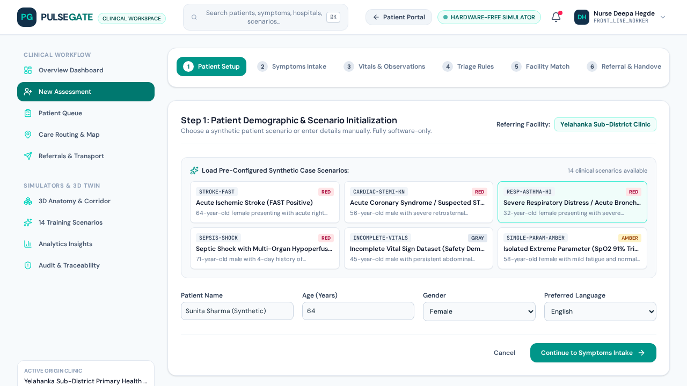
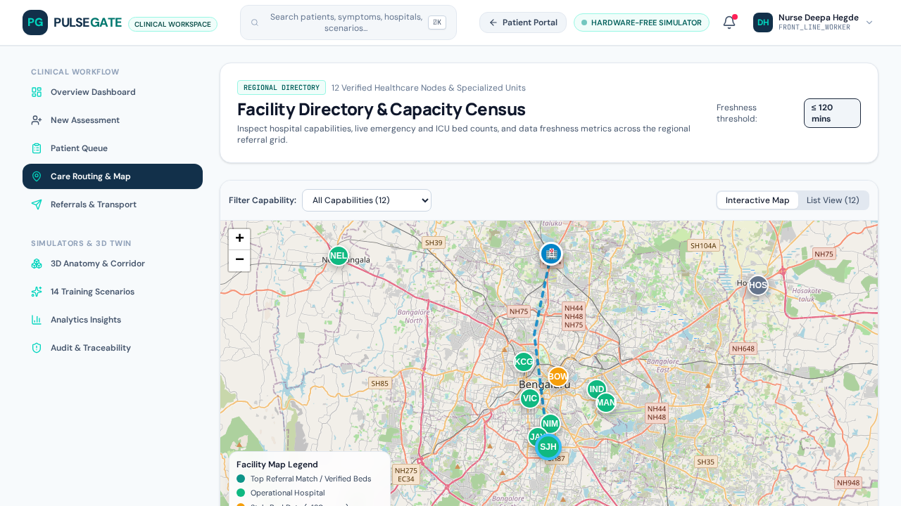
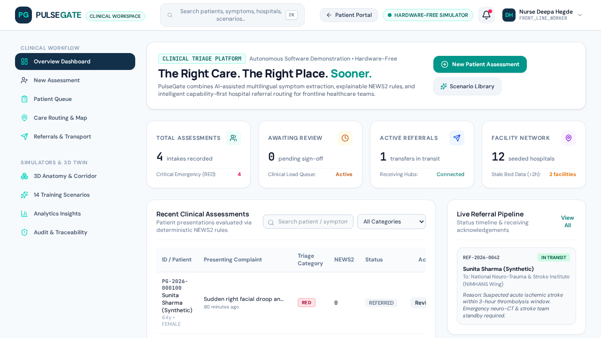

# PulseGate

**The Right Care. The Right Place. Sooner.**

PulseGate is an explainable clinical triage and smart referral platform for frontline healthcare teams. It combines deterministic, rule-based clinical decision support with facility-aware referral routing, so a care team can see not only *what* a patient's urgency level is, but *why*, and where to send them.

> **Status:** early-stage prototype, not validated for clinical use. Do not use it to make real patient-care decisions.

Live demo: https://pulsegate.ai.studio

## Why PulseGate

- **Delayed or wrong-level triage** costs time in settings where every minute matters.
- **Patients are often referred to a facility that can't treat them**, causing repeat referrals and lost time.
- **Opaque AI-only tools are hard to trust.** PulseGate keeps the core triage logic deterministic and auditable, so a clinician can inspect every step.

## Features

| Area | What it does |
|---|---|
| Symptom intake | Guided capture of presenting symptoms |
| Assessment wizard | Step-by-step structured assessment feeding the triage rules |
| Explainable triage | [Describe: urgency levels, which rules fired, how the result is explained] |
| Smart referral | [Describe: how facilities are matched, e.g. capability, distance, capacity] |
| Facilities map | Map view of referral facilities |
| Patient portal | Patient-facing home and portal views |
| Provider workspace | Clinician-facing workspace for reviewing cases and referrals |
| Training scenarios | Practice cases for care teams |
| 3D digital twin | Three.js-based visualisation [describe what it shows] |

Screenshots are in the repo root: `landing_page.png`, `symptoms_intake.png`, `assessment_wizard.png`, `facilities_map.png`, `patient_home.png`, `patient_portal.png`, `provider_workspace.png`, `training_scenarios.png`, `threejs_twin.png`. Embed the best 3 or 4 here:

```md



```

## How triage works

[Fill in. This is the most important section. Cover:]

1. What inputs the rules take
2. Where the rules come from (e.g. a published triage standard such as ESI, MTS or WHO guidance, or your own clinical input). Cite sources.
3. How the final urgency level is produced
4. How the explanation shown to the clinician is generated
5. Whether any AI model is used, for what, and what stays deterministic

## Tech stack

- Vite + TypeScript
- [React / other framework: confirm]
- Three.js (3D view)
- [Mapping library: confirm]
- [AI model/API, if any: confirm]
- Package manager: Bun (`bun.lock`)

## Getting started

```bash
git clone https://github.com/Yashasnaik19/Pulsegate.git
cd Pulsegate
bun install            # or: npm install
cp .env.example .env   # then add any required keys
bun run dev            # or: npm run dev
```

Check `package.json` for the exact script names.

## Project structure

```
src/                 application source
index.html           app entry
vite.config.ts       build configuration
.env.example         environment variable template
*.png                screenshots
```

## Limitations and safety

- Not a medical device and not clinically validated.
- Triage rules are [describe source and review status].
- No real patient data should be entered. [Describe how data is handled.]

## Roadmap

- [ ] Add automated tests for the triage rules
- [ ] Document and cite the clinical sources behind each rule
- [ ] Clinician review of the rule set
- [ ] First tagged release (v0.1.0)
- [ ] [Your next goal]

## Contributing

Issues and pull requests are welcome, especially from clinicians and developers with triage or referral-workflow experience. Please open an issue first for larger changes.

## License

[Choose one, e.g. MIT, and add a `LICENSE` file.]
